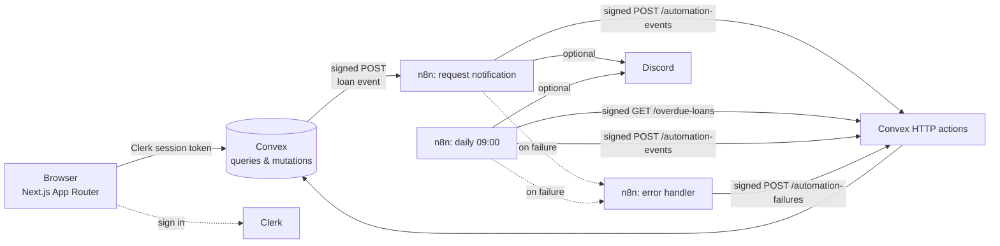

<h1 align="center">LendLoop</h1>

<p align="center">
  <b>Borrow what you need. Lend what you don't.</b><br>
  A neighbourhood tool-lending board with role-based access in Convex and signed, idempotent n8n automations.
</p>

<p align="center">
  <a href="#run-it-locally">Run it locally</a> ·
  <a href="#how-it-works">How it works</a> ·
  <a href="#security-and-data-minimization">Security</a> ·
  <a href="#automations-with-n8n">n8n automations</a> ·
  <a href="PRODUCTION.md">Production notes</a>
</p>

<p align="center">
  <a href="https://github.com/alihdrndm/lendloop/actions/workflows/ci.yml"></a>
  
  
  
  
  
</p>

---

Bo needs a ladder for one weekend. Lee has one in the shed and uses it twice a year. LendLoop connects them: Lee lists the ladder, Bo asks to borrow it for Saturday and Sunday, Lee approves with one click, and both of them get a short message. If Monday comes and the ladder is still at Bo's, a friendly reminder goes out the next morning. Nobody has to chase anyone.

Under the small UI there are two things this take-home is really about:

1. **Every permission is enforced in Convex**, not in React. A forged request from the browser gets `FORBIDDEN`, and the tests prove it.
2. **The n8n automations are built like production integrations**: HMAC-signed in both directions, idempotent write-backs, retries, and an error workflow, so a failure is visible instead of silent.

## What you can do

| As a visitor | As a member | As an admin |
|---|---|---|
| See which tools are available (name and category only) | List, edit and delete your own tools | Remove any listing |
| Sign in | Browse every tool with its status, filter by category | See every loan |
| | Request a tool for a date range | Mark a member as a **Trusted Lender** |
| | Approve or decline requests for your tools | See automation failures |
| | Mark a loan as returned | |
| | See "My listings", "My requests" and "Incoming requests", each loan with its automation activity ("Reminder sent 2 days ago") | |

## Run it locally

You need Node 24, pnpm, Docker and a free Clerk account. Convex runs locally without an account.

```bash
git clone https://github.com/alihdrndm/lendloop && cd lendloop
pnpm install
```

**1. Convex (local backend, no account).** This writes `NEXT_PUBLIC_CONVEX_URL` and friends to `.env.local` and keeps running:

```bash
CONVEX_AGENT_MODE=anonymous npx convex dev
```

**2. Clerk.** Create an application at [dashboard.clerk.com](https://dashboard.clerk.com) with Email (and Google if you like), then:

- **Integrations → Convex → Activate.** Copy the Frontend API URL.
- **Sessions → Customize session token**, set the claims to:
  ```json
  { "aud": "convex", "email": "{{user.primary_email_address}}", "name": "{{user.full_name}}" }
  ```
- **API keys**: add `NEXT_PUBLIC_CLERK_PUBLISHABLE_KEY` and `CLERK_SECRET_KEY` to `.env.local`.

**3. Convex environment.**

```bash
export CONVEX_AGENT_MODE=anonymous
npx convex env set CLERK_JWT_ISSUER_DOMAIN https://<your-app>.clerk.accounts.dev
npx convex env set ADMIN_EMAILS you@example.com
# Secrets shared with n8n, one per direction:
npx convex env set N8N_INBOUND_SECRET "$(openssl rand -hex 32)"
npx convex env set CONVEX_INBOUND_SECRET "$(openssl rand -hex 32)"
npx convex env set N8N_REQUEST_WEBHOOK_URL http://localhost:5678/webhook/lendloop-request
```

**4. n8n.** Copy `n8n/.env.example` to `n8n/.env` and put the same two secrets in it (`LENDLOOP_N8N_SECRET` = `N8N_INBOUND_SECRET`, `LENDLOOP_CONVEX_SECRET` = `CONVEX_INBOUND_SECRET`). Then:

```bash
docker compose up -d
```

The container imports and publishes the three workflows from `n8n/workflows` on every start, so what runs is always what's in the repo. The n8n editor is at [localhost:5678](http://localhost:5678).

**5. The app.**

```bash
pnpm dev
```

Open [localhost:3000](http://localhost:3000) and sign up. In a Clerk development instance, any email with `+clerk_test` (for example `bo+clerk_test@example.com`) accepts the verification code `424242`, so you can create a lender and a borrower in a minute.

**6. Demo data (optional).** With two members signed up:

```bash
npx convex run dev:seedDemo                 # tools + a loan that ended two days ago
docker compose exec -e N8N_RUNNERS_BROKER_PORT=5690 n8n n8n execute --id lendloopOverdues
```

The second command runs the daily reminder job now. The overdue loan shows **Reminder sent just now**; run it again and it still shows one reminder.

### Environment variables

| Where | Name | What it's for |
|---|---|---|
| `.env.local` | `NEXT_PUBLIC_CONVEX_URL`, `NEXT_PUBLIC_CONVEX_SITE_URL`, `CONVEX_DEPLOYMENT` | Written by `npx convex dev` |
| `.env.local` | `NEXT_PUBLIC_CLERK_PUBLISHABLE_KEY`, `CLERK_SECRET_KEY` | Clerk API keys |
| Convex | `CLERK_JWT_ISSUER_DOMAIN` | Clerk Frontend API URL; Convex only trusts tokens from it |
| Convex | `ADMIN_EMAILS` | Comma-separated admin emails. The only way to become an admin |
| Convex | `N8N_REQUEST_WEBHOOK_URL` | Where loan events are sent |
| Convex | `N8N_INBOUND_SECRET` | Signs Convex → n8n requests |
| Convex | `CONVEX_INBOUND_SECRET` | Verifies n8n → Convex requests |
| `n8n/.env` | `LENDLOOP_N8N_SECRET` | Same value as `N8N_INBOUND_SECRET` |
| `n8n/.env` | `LENDLOOP_CONVEX_SECRET` | Same value as `CONVEX_INBOUND_SECRET` |
| `n8n/.env` | `LENDLOOP_CONVEX_SITE_URL` | Convex HTTP actions URL from inside the container (`http://host.docker.internal:3211` locally) |
| `n8n/.env` | `DISCORD_WEBHOOK_URL` | Optional. Also post notifications to a Discord channel |

No secret is committed. The exported workflow JSON reads every secret and URL from the container environment at run time.

## How it works



- **Next.js 16 (App Router)** renders the UI. Pages are client components that subscribe to Convex queries, so changes (an approval, a reminder written back by n8n) appear live without a refresh. `src/proxy.ts` redirects signed-out visitors away from `/app`.
- **Clerk** handles sign-in. Its session token (audience `convex`, plus email and name claims) is passed to Convex on every call.
- **Convex** holds the data and every rule. Public functions are what the browser calls; internal functions are what the automations use; HTTP actions in `convex/http.ts` are the only door n8n has.
- **n8n** runs three workflows, imported from `n8n/workflows/` (generated from `n8n/build-workflows.py`, so they can be reviewed as code).

### Data model

| Table | Holds |
|---|---|
| `users` | Clerk identity, display name, email, `role` (`admin` / `user`), `trustedLender` |
| `tools` | Owner, name, category, condition, description, `removedAt` (soft delete keeps loan history) |
| `loans` | Tool, lender, borrower, `startDate` / `endDate` (calendar days), `status` |
| `automationEvents` | What n8n did for a loan (notification or reminder), its channel, and a unique `idempotencyKey` |
| `automationFailures` | Runs that failed for good, from Convex retries or the n8n error workflow |

### Loan rules

```
requested ──► approved ──► returned
    │   (lender)    (lender or borrower)
    ├──► declined   (lender)
    └──► cancelled  (borrower)
```

Enforced in `convex/loans.ts`: you can't borrow your own tool, dates must be valid and not in the past, loans are capped at 60 days, approved loans can't overlap, and each transition can happen once.

## Security and data minimization

**Authorization lives in Convex** (see [ADR 0001](docs/adr/0001-convex-is-the-authorization-boundary.md)).

| Action | Who | Enforced by |
|---|---|---|
| List / edit / delete a tool | The owner | `assertOwnsTool` in `tools.update` / `tools.remove` |
| Remove any listing | Admin | `tools.remove` checks `role === "admin"` |
| Request a tool | Any member except the owner | `loans.request` |
| Approve / decline | The lender of that loan | `loans.decide` |
| Cancel | The borrower, while pending | `loans.cancel` |
| Mark returned | Lender or borrower, once approved | `loans.markReturned` |
| See all loans, members, failures; set Trusted Lender | Admin | `requireAdmin` |

- Roles come from `ADMIN_EMAILS` on the server, re-checked at every sign-in. The client never sends a role.
- The **public list returns only name and category** of available tools. No owner, no description, no ids that point at people.
- Inputs are trimmed and length-limited on the server; errors reach the UI as plain sentences, not stack traces.

**The n8n integration** (see [ADR 0002](docs/adr/0002-signed-idempotent-n8n-integration.md)):

- **Signed both ways.** `x-lendloop-signature = hex(HMAC_SHA256(secret, timestamp + "." + body))` with a 5-minute window against replays and a constant-time compare. Each direction has its own secret. An unsigned or altered request gets `401`.
- **Exact bytes.** Convex sends `{"payload": "<json string>"}` and signs the inner string, so n8n verifies exactly what was signed. GET requests sign `GET <path>`.
- **Idempotent write-backs.** Every write-back carries a key that doesn't change on retry: `req:<loanId>:<status>` for notifications, `overdue:<loanId>:<YYYY-MM-DD>` for reminders. Convex keeps one row per key, so retries never duplicate a record or a reminder.
- **Least data.** Webhook payloads carry first names, the tool name and dates, plus the recipient's email only because a real email step would need it. The overdue endpoint returns exactly `loanId`, `toolName`, `endDate` and the borrower's first name and email, and a test locks that down. Logs use first names only.
- **Secrets** live in the Convex environment and the n8n container environment, never in code or in the exported workflow JSON.

## Automations with n8n

| Workflow | Trigger | What it does |
|---|---|---|
| **Request notification** | Webhook, called by Convex on every loan status change | Verifies the signature (401 if not valid) → writes a short message to the right person (lender for a new request, borrower afterwards) → logs it and posts to Discord if configured → signed, idempotent write-back so the loan shows "Notification sent" |
| **Overdue reminders** | Every day at 09:00 UTC (plus a manual trigger) | Signed GET of overdue loans → one reminder per borrower → signed write-back with a per-day idempotency key |
| **Error handler** | Any failed run of the two above | Describes where and why it failed (never the payload) → signed POST to Convex → shown to admins under **Automation problems** |

Reliability:

- Convex schedules the notification **inside the same transaction** as the status change (`convex/lib/notify.ts`): no change without a notification, and no notification for a change that rolled back.
- Delivery to n8n runs in an action that **retries 4 times** with backoff (0 s, 5 s, 30 s, 2 min), then records an automation failure.
- Every n8n HTTP node **retries 3 times**; anything that still fails triggers the error workflow.

## Tests

```bash
pnpm test        # 20 tests
pnpm typecheck   # Next.js and Convex
pnpm lint
```

- `convex/rbac.test.ts`: roles, ownership, the public list leaking nothing, the loan state machine, overlap and date rules.
- `convex/hmac.test.ts`: signing, tampering, wrong secret, replay window, and a known vector that pins the Web Crypto output to Node's `crypto` (what n8n uses).
- `convex/http.test.ts`: unsigned and wrongly signed calls get 401, write-backs are idempotent, bad payloads get 400, and the overdue endpoint returns only the minimal fields.

CI runs lint, typecheck and tests on every push, and fails if the workflow JSON drifts from `n8n/build-workflows.py`.

## Project layout

```
convex/
  schema.ts            tables and indexes
  lib/auth.ts          requireUser, requireAdmin, ownership checks
  lib/hmac.ts          request signing shared with n8n
  lib/notify.ts        queues the n8n notification inside each loan change
  tools.ts loans.ts users.ts
  automation.ts        delivery with retries, idempotent event and failure records
  http.ts              signed endpoints for n8n
  dev.ts               CLI-only demo seed
src/
  app/page.tsx         public board
  app/app/*            browse, listings, requests, incoming, admin
  components/          small UI primitives, loan card, forms
  proxy.ts             redirects signed-out visitors away from /app
n8n/
  build-workflows.py   readable source of the workflows
  workflows/*.json     exported workflows, imported on container start
  start.sh             import + publish + start
docs/adr/              architecture decisions
```

## Troubleshooting

- **No "Admin" link:** your email isn't in `ADMIN_EMAILS`, or the Clerk session token is missing the `email` claim (step 2). Sign out and in again after changing either.
- **Loans never show "Notification sent":** check `docker compose logs n8n`, that `N8N_REQUEST_WEBHOOK_URL` is set in Convex, and that the two secrets match between Convex and `n8n/.env`. Rejected calls are logged on both sides with the reason (`missing`, `stale` or `mismatch`).
- **n8n can't reach Convex:** inside Docker, Convex is `http://host.docker.internal:3211`, not `127.0.0.1`.
- **`n8n execute` says port 5679 is in use:** pass `-e N8N_RUNNERS_BROKER_PORT=5690` as shown above.

---

What I would change before real neighbours use it is in [PRODUCTION.md](PRODUCTION.md).
